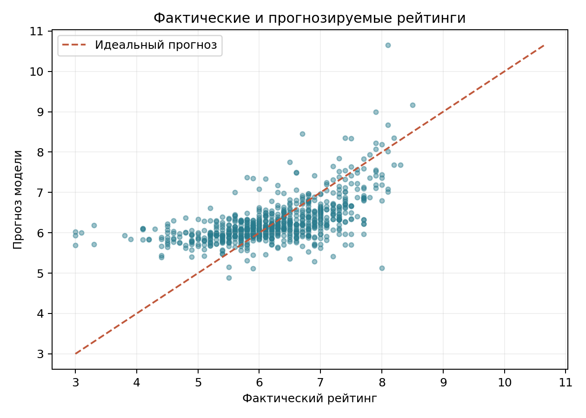

# Анализ рейтингов фильмов

Исследовательский проект на данных **TMDB 5000 Movie Dataset**. Цель — проверить, как пользовательский рейтинг связан с бюджетом, продолжительностью, популярностью, числом голосов, годом выпуска и жанром фильма.

## Результат

| Показатель | Значение |
| --- | ---: |
| Фильмов в исходной таблице | 4 803 |
| Фильмов после отбора для модели | 3 749 |
| Обучающая / тестовая выборка | 2 999 / 750 |
| R² на тестовой выборке | 0,3459 |
| MAE на тестовой выборке | 0,5401 балла |
| RMSE на тестовой выборке | 0,7187 балла |

Модель объясняет часть различий в оценках, но недостаточно точна для надёжного прогноза отдельного фильма. Популярность и число голосов известны после выхода, поэтому текущую модель нельзя использовать как прогноз рейтинга до премьеры. Связи между признаками и рейтингом не означают причинного влияния.



## Что внутри

- [`reports/Исследование_рейтингов_фильмов.pdf`](reports/Исследование_рейтингов_фильмов.pdf) — краткий отчёт с методикой, результатами и ограничениями.
- [`src/regression.py`](src/regression.py) — очистка данных, обучение модели, метрики и диагностический график.
- [`src/directors.py`](src/directors.py) — дополнительный анализ средних рейтингов режиссёров с минимум пятью фильмами.
- [`data/DS.db`](data/DS.db) — подготовленная SQLite таблица `dataset_5000`.

## Запуск

```bash
python -m venv .venv
source .venv/bin/activate
pip install -r requirements.txt
python src/regression.py
python src/directors.py
```

Скрипты читают `data/DS.db` относительно корня проекта и обновляют графики в `reports/`. Проверенный запуск использовал Python 3.9, pandas 1.3.4, scikit-learn 0.24.2 и matplotlib 3.4.3.

## Данные и ограничения

Источник: [TMDB 5000 Movie Dataset на Kaggle](https://www.kaggle.com/datasets/tmdb/tmdb-movie-metadata/data). Проект использует данные The Movie Database (TMDB) и не одобрен и не сертифицирован TMDB. Подготовленная база содержит исходные записи и дополнительные вычисленные поля; выборка не представляет все существующие фильмы.

Из модели исключены записи с пропусками в используемых полях, неположительными рейтингом, бюджетом, продолжительностью или годом выпуска, а также с пустым основным жанром. Такой отбор может смещать результаты. Режиссёрский рейтинг рассчитан только для групп из не менее пяти уникальных фильмов и зависит от состава датасета.
